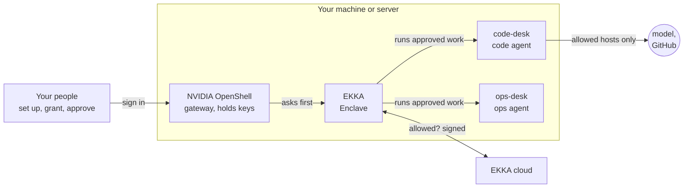

# How it works

[Back to the start](../README.md)

NVIDIA OpenShell runs agents in sandboxes and holds every program and network call to a policy. EKKA adds what a company needs on top: who may run which work, where the keys live, and a record that shows any tampering.

## The parts



The roles are simple. **People** set desks up, connect the company's keys, give permissions and approve decisions. **Agents** do the work on the desks, and only through EKKA.

| Part | What it is | Where it runs |
|---|---|---|
| **Desk** | A workspace OpenShell isolates for one agent's job, with the repositories it needs. The agent works here, and only here. | your machine |
| **Gateway** | NVIDIA's OpenShell gateway. It creates desks, holds your keys and enforces each desk's network policy. | your machine |
| **Enclave** | EKKA's counterpart on your machine, there to keep your data private. It carries out the work EKKA's cloud allowed, holds secrets in its own vault, and answers OpenShell before every action that matters. | your machine |
| **EKKA cloud** | Decides: checks each step of a plan against your grants, keeps the prompts, and signs the record. It never needs your code or your keys. | EKKA |
| **Sign-in** | Keycloak, for your team's sign-in to the gateway. | your machine |

Repository copies and provider credentials are held on your server. The model provider receives the code context sent by the agent. EKKA's cloud receives the plan, run inputs such as your question, decisions, and execution records.

## Every OpenShell action EKKA checks

OpenShell lets an outside service approve or refuse an action before it happens (an *interceptor*). EKKA is that service. If the Enclave is not running, the gateway does not start: no action can skip the check.

| OpenShell action | What EKKA does |
|---|---|
| Create a desk | Allowed for a desk change run through EKKA (`ekka desk create`, on the installed machine). Refused for the Enclave's machine identity: the Enclave runs work on desks, it never makes them on its own. |
| Delete a desk | Allowed for a desk change run through EKKA (`ekka desk delete`), recorded. Refused for the Enclave's machine identity. |
| Change a desk's policy | Only a desk change run through EKKA, with a complete and valid policy. Never the desk itself, never the Enclave's machine identity, never while a job runs on that desk. |
| Propose a policy change from inside a desk | Telemetry is allowed; any proposed change is refused. |
| Attach a key to an existing desk | EKKA decides, for that exact key: yes, no, or wait for a person's decision. Never while a job runs. Recorded. |
| Detach a key | Never while a job runs. Recorded. |
| Add, change or remove a key | Never while a job runs. Recorded. |
| Add or change a provider profile | Every host in it must be enforced, never audit-only. Never while a job runs. Recorded. |
| Remove a provider profile | Never while a job runs. Recorded. |
| Open an SSH session into a desk | Refused: another way into the desk. |
| Expose a service from a desk | Refused: another way out of the desk. |

That is 23 checks: 14 before an action and 9 recording what was done. They are listed in [`deploy/gateway/gateway.toml.template`](../deploy/gateway/gateway.toml.template).

## Where your keys live

```text
your API key ──(standard input)──▶ sudo ekka desk connect ──▶ gateway's key store
                                                           │
desk sees:   ANTHROPIC_API_KEY=openshell:resolve:env:...   │ placeholder only
                                                           ▼
request to api.anthropic.com ──▶ gateway swaps in the real key ──▶ Anthropic
request to any other host     ──▶ no key, or refused by the desk's policy
```

- A key is read from standard input, never from a command-line argument, a file or a log.
- `ekka desk profile show <profile>` prints where a key will be sent and which programs may use it. Those words come from the provider profile.
- The gateway gives a key to a request only when the request goes to a host in that key's profile. So each profile lists only hosts its own vendor runs (this repository changes NVIDIA's Claude Code profile for exactly that reason; see [Provider profiles](../providers/README.md)).

## How a job runs

```text
ekka plan run ekka.example.desk.ask.codeDesk.v1 --input question="..."
  1. EKKA checks the plan against your grants: may this agent run a job on desks/code-desk?
  2. EKKA puts the step's prompt, and its SHA-256, in the signed request
  3. the Enclave checks the signature and the prompt's SHA-256, then starts the job on the desk
  4. the agent works on the desk, with only the keys and hosts the desk allows
  5. the Enclave collects the declared outputs and their digests
  6. EKKA signs the record: who asked, which plan and prompt, which desk, what came back
```

- **Prompts are versioned.** A plan names a prompt and its version (`desk-ask` version 4 for the server example). EKKA keeps the text; a version never changes. If the text the Enclave receives differs from its SHA-256, the job does not start.
- **Grants say what an agent may touch.** The install creates one agent for desk work, the *desks agent*, and one grant that lets it run jobs on every desk on the server (`desks/*`). Remove the grant, and no further job runs anywhere. Read grants with `ekka gate grant list`.
- **Decisions wait for a person.** A plan can stop and ask a person to decide before it continues. See them with `ekka decide list`, answer with `ekka decide answer`.
- **Records are tamper-evident.** They are signed and chained, so any later change would show. Read one with `ekka receipts show <run>`; check the whole record with `ekka receipts verify`.

## What a desk can reach

Each desk has a policy, which OpenShell enforces for every program in it:

- **Hosts:** the default policy lets `/usr/bin/git` read repositories from `github.com` over HTTPS, without a key for public repositories. Attached provider profiles add their own destinations, such as `api.anthropic.com` for `claude-code`.
- **Git operations:** the default GitHub rule allows reference discovery and `git-upload-pack` (clone and fetch), not `git-receive-pack` (push). It permits reads across GitHub, not just a fixed repository list. Review repository content as untrusted input; this rule is not a guarantee that no data can leave in an allowed request.
- **Existing desks:** upgrading the default does not replace an existing desk's pinned policy. The new default applies when creating a desk; policy changes remain governed separately.
- **Programs:** only the programs each key names may use it (`claude` for the Anthropic key; `git` and `gh` for GitHub).
- **Files:** system folders are read-only; programs write only to the work folder (`/sandbox/ekka-workspace`) and `/tmp`, as a normal user.

Read a desk's policy in plain words with `ekka desk policy show code-desk`. Change it on the installed machine with `ekka desk allow` and `ekka desk deny` (see [Commands](COMMANDS.md)).

## Desks register themselves

When you make a desk with `ekka desk create`, the gateway labels it, and the Enclave adds it to EKKA by itself and pins it (the desk's identity and policy). If a still-pinned desk is unexpectedly replaced by a different one with the same name, the Enclave refuses to run work on it until a person approves the new one with `ekka desk repin`.

## What this setup does not do

- It does not host your code or your keys. Both stay on your machine.
- It does not replace OpenShell's own policy engine. EKKA adds checks before and records after; OpenShell still enforces the desk.
- It does not make your machine safe on its own. Follow [A server for your team](SERVER.md) for the firewall and sign-in.
